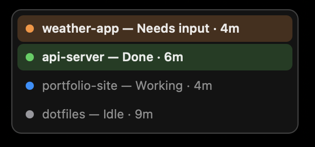
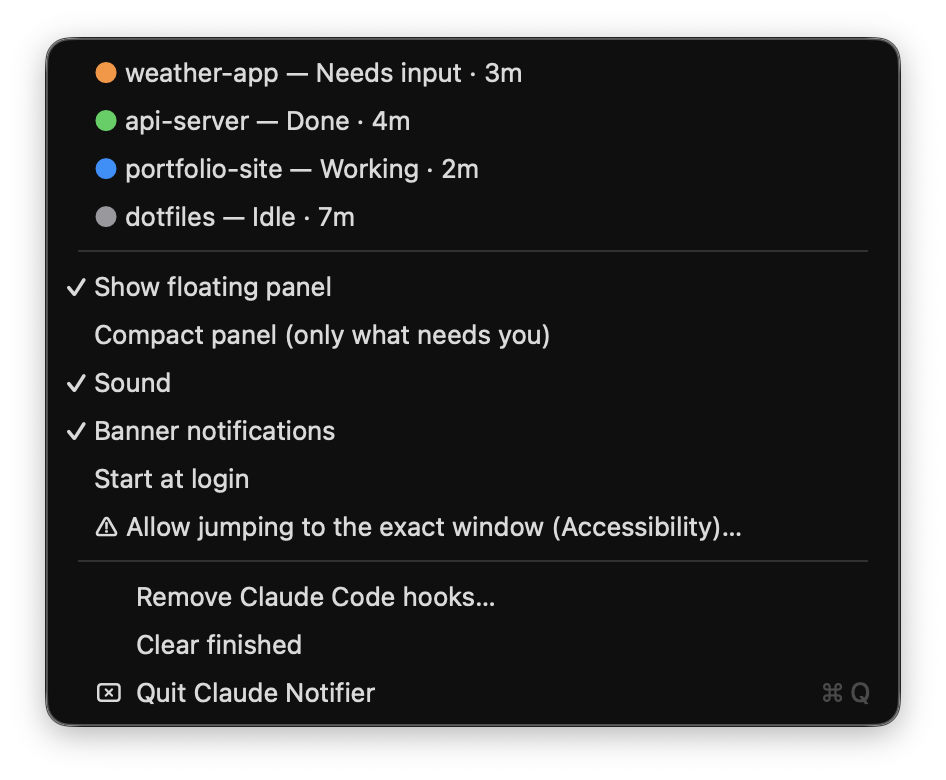

# Claude Notifier

A tiny macOS menu-bar app with an always-on-top floating panel that shows every local
[Claude Code](https://claude.com/claude-code) session and its status: **Working**,
**Done** or **Needs input**. It works whether Claude runs in Android Studio / JetBrains IDEs,
Terminal, iTerm, VS Code or any other terminal.

## Screenshots

| Floating panel | Menu-bar menu |
|---|---|
|  |  |

## Features

- Floating panel and menu-bar badge listing every running Claude Code session
- Color-coded status: working (blue), done (green), needs input (orange)
- Click a row to jump to that session. JetBrains IDEs focus the exact project window;
  other terminal apps are brought to the front. Right-click dismisses a row.
- Optional sound and banner notifications
- Starts at login; one-click setup and uninstall from the menu bar

## Requirements

- macOS 13 or later
- `python3` and `swiftc` (both come with the Xcode Command Line Tools: `xcode-select --install`)

## Install

### From source

```bash
git clone https://github.com/Firozmemon/claude-notifier.git ~/.claude/claude-notifier
cd ~/.claude/claude-notifier
./install.sh
```

This builds `ClaudeNotifier.app` into `~/Applications` and launches it.

### As a DMG

```bash
./build-dmg.sh 1.0   # writes dist/ClaudeNotifier-1.0.dmg (universal: Apple Silicon + Intel)
```

The app is not notarized, so macOS blocks it the first time. Allow it in
**System Settings → Privacy & Security → Open Anyway**, or run:

```bash
xattr -dr com.apple.quarantine "/Applications/Claude Notifier.app"
```

## Setup

1. Open the app and click **Set Up** when asked. This adds status hooks to
   `~/.claude/settings.json`. A backup is saved as `settings.json.bak-notifier`.
2. Restart any Claude Code sessions that are already running.
3. The first time you click a row, macOS asks for **Accessibility** permission.
   It is needed to raise the exact project window.

## How it works

- `hook.py` is registered as a Claude Code hook. On each event it writes one small JSON
  status file per session to `~/.claude/claude-notifier/state/`.
- `ClaudeNotifier.app` (`ClaudeNotifier.swift`) watches that folder and renders the panel
  and menu-bar item.

Hook management from the command line:

```bash
python3 hook.py --install     # add hooks to ~/.claude/settings.json
python3 hook.py --uninstall   # remove only the notifier's hooks
python3 hook.py --status
```

## Uninstall

Use **Uninstall** in the menu-bar menu (removes the hooks), then delete
`~/Applications/ClaudeNotifier.app` (or `/Applications/Claude Notifier.app`) and
`~/.claude/claude-notifier`.

## License

[MIT](LICENSE)
